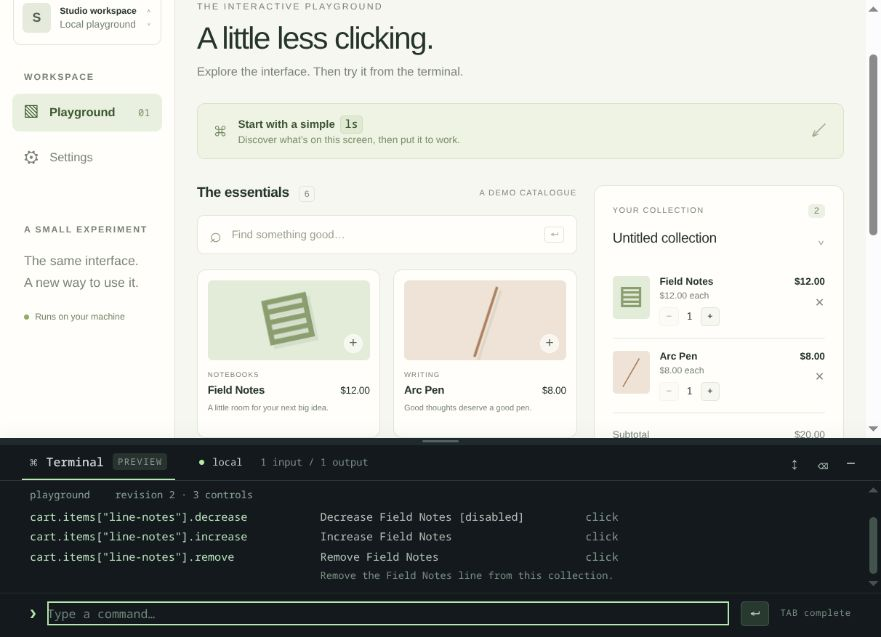
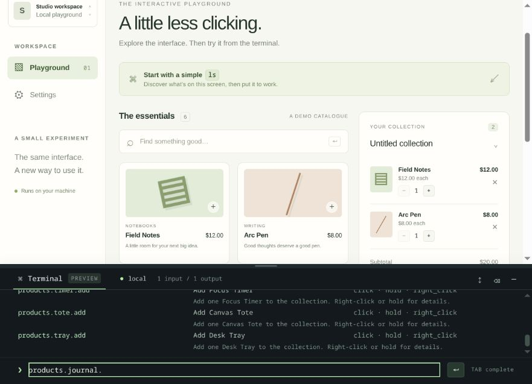
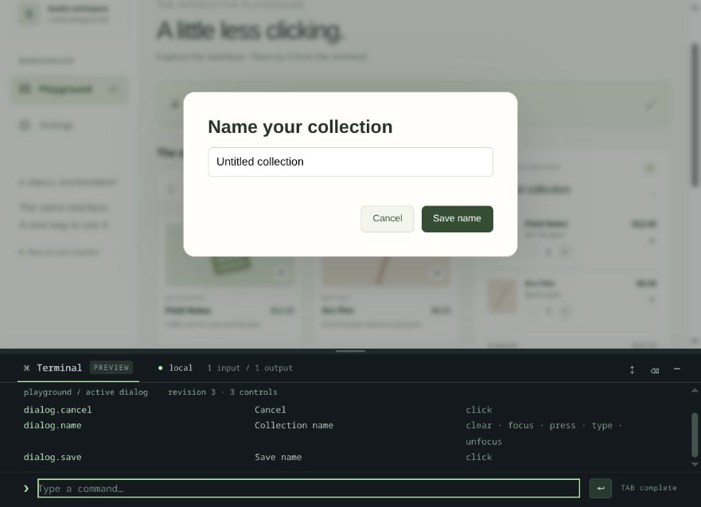

# UI Terminal

**A terminal for your React application's visible interface.**

A standalone terminal for your application's visible controls. Components describe
themselves; people discover them with `ls` and operate them through the same
handlers as the normal interface.

This is an independent **local browser prototype**, version `0.1.0-dev.0`, under a
temporary npm package name. This is a private development repository; the package
is not published to npm. Its public package name and licence remain undecided.
The library has no FayPOS runtime dependency.



## What works today

- Declarative React buttons and fields, with optional stable IDs and descriptions.
- One command processor, one active input/output attachment and a visible cursor.
- Screen/dialog-scoped `ls`, shared navigation and revision-based change output.
- Normal UI handlers, disabled-state checks, secret-field exclusion and target
  revalidation before activation.
- A bottom-docked terminal with resizing, completion and failed-command history.
- An independent demo, 28 engine tests, 11 browser flows and clean-package checks.

Browser/React DOM is the implemented platform. Native adapters and an external
local-server attachment are planned; see [current limits](#current-limits).

## Run locally

Requires Node 22.12+ and npm. From this directory:

```sh
git clone https://github.com/Hanzla-Double3/ui-terminal.git
cd ui-terminal
npm ci
npm run dev
```

Open **http://127.0.0.1:18120/**. The loopback-only Vite server serves the example
UI; it is not a remote command server. The command engine itself runs inside the
app, entirely in memory. No account, database, AI service or API key is needed.
The demo's Save button explicitly saves its sample collection in browser storage.
It does not restore or create real store/customer records.

```sh
npm test                  # TypeScript library build + sequential engine tests
npm run build             # Types, independent library and production demo
npm run test:package      # Pack/install in a clean consumer; core + React checks
npx playwright install chromium
npm run test:browser      # Isolated browser regression suite, one worker
npm run preview           # Serve the built demo instead of the dev server
```

Stop the dev server with Ctrl+C before starting preview on the same port. Heavy
build/test scripts use a shared Linux build lock, two allowed CPUs, lower priority
and a 2 GiB Node heap ceiling; they run sequentially. These are local development
scripts, not dependencies of the browser library.

## Try it

The terminal starts open in the demo. Type one line at a time:

```text
ls
search.type("Field")
search.press("Enter")
ls cart
cart.items["line-notes"].increase.click()
cart.save.click()
ls --changes
cart.name.right_click()
ls
dialog.name.type("My collection")
dialog.save.click()
```

`ls` describes the current screen/dialog. `ls navigation` lists shared navigation;
`ls --all` includes it with the current screen. `ls --visible` applies viewport
actionability checks. `ls --changes` compares with the most recent successful,
complete inspection of that attachment. It does not repeatedly dump navigation.

The dock resizes from its top edge and with Up/Down while that edge is focused.
Minimize/restore preserves its height. Ctrl/Cmd+backtick toggles the panel. Tab
completes the shared prefix of discovered paths before listing options:
`products.j` becomes `products.journal.`. Up/Down recall submissions including failed commands.
Default-private text is redacted; redacted entries require re-entry, not replay.

## Add controls

```tsx
import {
  TerminalProvider,
  TerminalScope,
  Button,
  Field,
} from "ui-terminal-local/react";
import { TerminalPanel } from "ui-terminal-local/panel";
import "ui-terminal-local/panel.css";

function Application() {
  return (
    <TerminalProvider enabled={true} scope="my-app/session-1">
      <TerminalScope id="workspace" kind="screen">
        <Button
          cli={{ id: "save", description: "Save the current document" }}
          onClick={saveDocument}
        >
          Save
        </Button>
      </TerminalScope>
      <TerminalPanel title="Commands" defaultHeight={200} />
    </TerminalProvider>
  );
}
```

The package's default is disabled; the host owns its opt-in and opaque session
scope. Changing the host scope invalidates pending undispatched actions, clears
history/output and resets discovery baselines. Mount a separate provider/runtime
for each independent app root.

Use the controls in your shared design system. Roles and actions are inferred;
`cli` supplies stable IDs/descriptions. Without metadata, controls receive a local
mount identity and use their accessible label/text. `useTerminalControl` adapts
an existing DOM widget with its actual ref/actions. There is no React Fiber scan,
eval, shell, domain-API bridge or separate agent execution interface.

For explicit completion, return the result of the normal handler:

```tsx
import { confirmed } from "ui-terminal-local";

<Button
  cli={{ id: "save" }}
  onClick={async () => {
    await saveLocally();
    return confirmed({
      persistence: "local",
      sync: "pending",
      message: "Saved on this device.",
    });
  }}
>
  Save
</Button>;
```

A void handler reports **dispatched**, not a successful save. An explicit host
receipt identifies memory/local/server persistence. The terminal cannot infer
durability from a click, re-render or toast.

## One input / one output

The visible provider owns one active input/output attachment. The core is
platform-neutral and accepts the same command stream from a custom host:

```ts
import { createTerminal, createInput } from "ui-terminal-local";

const terminal = createTerminal({ enabled: true });
const input = createInput();
const connection = terminal.attach({
  input,
  output: {
    write(event) {
      console.log(event);
    },
  },
});
await input.send("help");
connection.detach();
```

That example has no registered application controls; `help` needs none. A second
attachment is rejected. The visible panel and engine tests use this same boundary.
`TerminalProvider` currently installs the visible attachment automatically; external
transport ownership/handoff is intentionally later work.

Output events are ordered, schema-versioned and sanitized before delivery. Session
history and transcript are bounded memory; they are not persisted or sent anywhere.
Output failure revokes the attachment and never retries a dispatched mutation.

## Current limits

- Browser/React DOM implemented. The engine is portable, but React Native/Android,
  native panel, Electron packaging and iOS acceptance are **not implemented/tested**.
- No external listening server, agent connector, test-client transport, MCP/WebMCP
  bridge or multiple input drivers. The future transport will relay the same lines
  and output events; it will not introduce per-feature execution APIs.
- List discovery covers mounted controls. There is no virtual-list data-source
  adapter, infinite-scroll pagination, arbitrary shadow-DOM or cross-frame control.
- Numeric indexed aliases are deliberately unsupported; use quoted stable keys.
- Only the listed actions are supported; Enter is the only `press` key. `hold` is
  one semantic long-press callback, not an OS mouse-down held for a duration.
- Secret/password/OTP or `cli.sensitive` controls are excluded. Only explicitly
  public field values (`exposeValue`) enter discovery or replayable text history.
- A cursor highlight is a visual aid. Synthetic browser activation does not grant
  trusted physical input or permission to automate OS/file-picker/payment dialogs.
- A timed-out action may still be running. The terminal reports an unknown outcome;
  check the app before retrying. It does not roll back dispatched host actions.
- The supplied Dialog is a web-demo primitive, not a replacement for a host's
  fully featured accessibility/dialog design system. Adapt existing dialogs using
  the same scope/layer rules when integrating.

See [manual walkthrough](docs/WALKTHROUGH.md), [stream contract](docs/STREAMS.md),
[verification record](docs/VERIFICATION.md) and [next steps](docs/ROADMAP.md).

## Screenshots

### Shared-prefix completion

After discovery, `products.j` + Tab fills `products.journal.` before listing
remaining alternatives.



### Active-dialog discovery

Opening a dialog changes the available terminal controls. Background actions stay
unavailable until the dialog closes.



These screenshots show disposable fixture data from the local demo. They are not
screenshots of a customer application or a deployed service.

## Documentation

| Document                                        | Contents                                                          |
| ----------------------------------------------- | ----------------------------------------------------------------- |
| [Architecture](docs/ARCHITECTURE.md)            | Runtime, component adapters, session ownership and execution flow |
| [React integration](docs/COMPONENTS.md)         | Providers, stable IDs, controls, custom widgets and styling       |
| [Input/output contract](docs/STREAMS.md)        | Events, receipts, errors, privacy and stream behavior             |
| [Walkthrough](docs/WALKTHROUGH.md)              | A step-by-step demo with expected UI outcomes                     |
| [Verification](docs/VERIFICATION.md)            | Checks performed and their practical limits                       |
| [Roadmap](docs/ROADMAP.md)                      | Work remaining before a cross-platform/public beta                |
| [Contributing](CONTRIBUTING.md)                 | Local workflow, tests and change review                           |
| [Screenshot maintenance](docs/images/README.md) | What each image demonstrates and when to refresh it               |

## Project status

The repository is private and the package has `private: true`. No npm release or
public open-source licence is granted by this prototype. Choose the final package
identity and licence before public publication; do not assume a missing licence
means unrestricted reuse.
