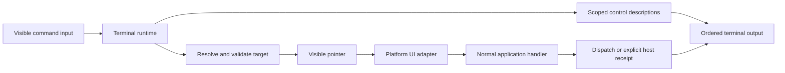

# Architecture

UI Terminal is a local command processor embedded in a host application. The
terminal is the single command interface; the UI tree supports discovery and
target resolution internally.

## Source layout

| Directory   | Responsibility                                                                        |
| ----------- | ------------------------------------------------------------------------------------- |
| `src/core`  | Parser, runtime, session ownership, target checks, snapshots/deltas and output events |
| `src/react` | Provider, declarative controls, semantic scopes and DOM interaction adapter           |
| `src/panel` | Visible terminal, history, completion, pointer presentation and CSS                   |
| `demo`      | Independent stationery catalogue/collection fixture using normal UI state             |
| `tests`     | Engine tests and real-browser regression flows                                        |
| `scripts`   | Sequential resource-limited builds and clean installed-package acceptance             |

The core imports neither React nor Node APIs. UI exports use React and React DOM
as optional peers. Installed-package tests verify that core commands work without
React installed and that the React/panel exports resolve from a clean consumer.

## Registration and identity

Controls register committed descriptors through public refs and React lifecycle
effects. Descriptors include path segments, labels, actions, active screen/layer,
disabled state, redaction policy and lazy geometry callbacks. Callbacks and refs
stay internal; output contains sanitized descriptions only.

`TerminalScope` builds semantic paths. Screens select visibility without adding
their name to every command. Navigation scopes can be discovered independently.
Items use stable IDs, not visual positions: `cart.items["line-notes"].remove`
continues to identify that line after other rows move. Duplicate paths are
ambiguous and cannot execute. Numeric indexed aliases are not implemented.

## Command execution

1. Input submits one bounded command line. The parser does not evaluate JavaScript.
2. The runtime records a sanitized history entry and checks enabled state, session
   identity and whether another command is active.
3. It resolves exactly one currently available control in the active screen/dialog.
4. It checks disabled state/action support, reveals through normal scrolling and
   validates DOM geometry and hit testing.
5. It displays the pointer, then checks the target's mount identity, label, session,
   layer and availability again before dispatch.
6. The adapter invokes the normal UI interaction once. DOM button activation uses
   the real event/default-action path; fields use normal input/change behavior.
7. Output distinguishes an unknown business outcome from an explicit host receipt.

The pointer is an in-app visual indicator, not OS-level mouse injection. Browser
user-activation restrictions and native OS dialogs remain outside the adapter.

## Sessions and output

Each runtime has its own input/output owner, history, session ID and discovery
baseline. The visible provider installs the pair automatically. A second owner
cannot silently replace it. Store/account/employee identities are opaque host
scope strings; the library knows nothing about their domain meaning.

Scope or enabled-state changes invalidate pending undispatched work, clear local
learning state and reset baselines. They cannot undo a host operation that has
already begun. Async receipts from a previous host scope cannot appear as results
of a new session.

Snapshots and deltas establish/advance baselines after successful delivery.
Truncated output cannot masquerade as a complete baseline. Output failure revokes
the attachment; it does not trigger a retry of the UI action.

## Host responsibilities

The host owns authentication, authorization, confirmations, validation, data
persistence, API calls and any offline sync. The terminal reuses its handlers.
Descriptions/labels are data, not agent instructions or authority to act.

The host must classify non-password secrets with `cli.sensitive` and explicitly
opt public field values into discovery/replay. The library is not a security
boundary against hostile JavaScript already executing inside the host.

## Future transports

External agents and test clients will attach to this same terminal protocol.
A listening local server, authentication, controller handoff and remote ingress
limits are future work. They must not introduce a second feature-specific
execution API. Native adapters will share the core, with separate geometry and
interaction implementations and actual platform acceptance tests.

## Host platform adapters

The `/adapter` export exposes control registration, screen/layer reporting and
pointer presentation only. Discovery/actions still use the single stream. This
allows a host to retain its native panel/controls without importing DOM code.
`actionable` may be asynchronous; after geometry resolves the runtime revalidates
the host session, registration identity, label and disabled state before dispatch.
`createSessionId` supplies a native UUID source. Byte budgets use portable UTF-8
counting rather than TextEncoder. Optional `detail` is bounded primitive metadata.
Numeric indices remain an opt-in legacy syntax that normalizes to string keys;
new hosts should use stable IDs. The DOM adapter continues to use public refs.

Read-only information shares this model: `Readout` contributes a value/detail
snapshot with no actions. It uses the existing controls array for compatibility;
`role: readout` distinguishes metrics/status/totals from interactive controls.
Neither discovery nor rendering derives backend permissions or fetches extra data.

## Filtered discovery (dev.3)

Use `ls --tree` for the current namespaces, then `ls --tree cart` to drill down.
Namespace rows are inspection-only summaries, not new actionable controls.
`ls --role readout` lists information; `ls --find "stock"` matches public labels,
descriptions, paths, values and metadata. These filters compose with a path or
`--visible`/`--all`. Private field values and secret/background/modal-excluded
controls are never searched. UI content remains data, never agent instructions.

`ls --limit 20 --offset 0` pages discovery with matched/offset/limit/nextOffset
metadata. The host maximum still caps page size; truncation/output limits remain
explicit. Pages do not establish a complete delta baseline. Use a narrower group
for `ls --changes`; filters persist on its most recent complete query. Stable
record IDs are preferred. Automatic component IDs live for the mounted widget,
so rediscover after navigation or remount. Discovery never submits or retries a
UI action and does not prove a durable save. No network listener is introduced.
